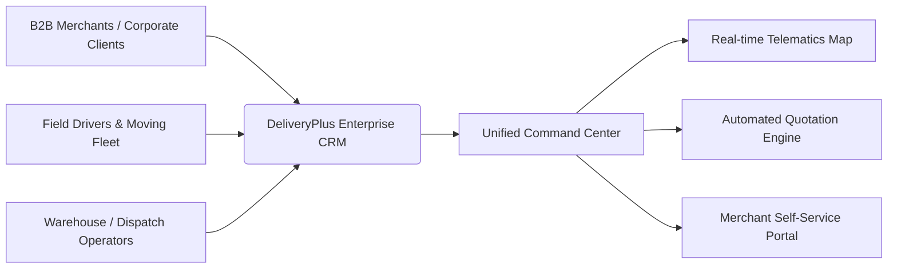
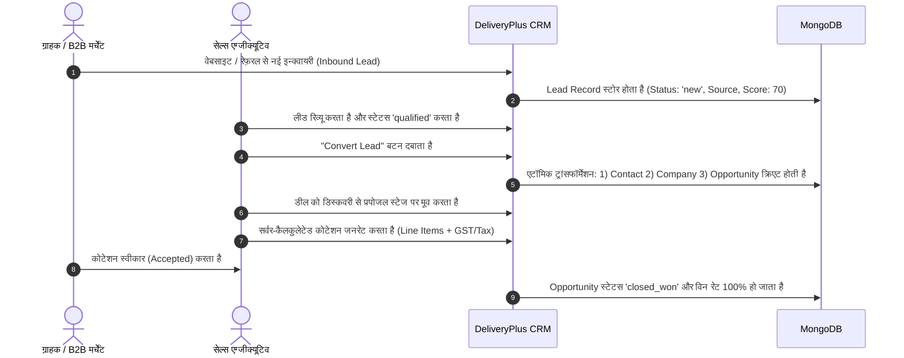
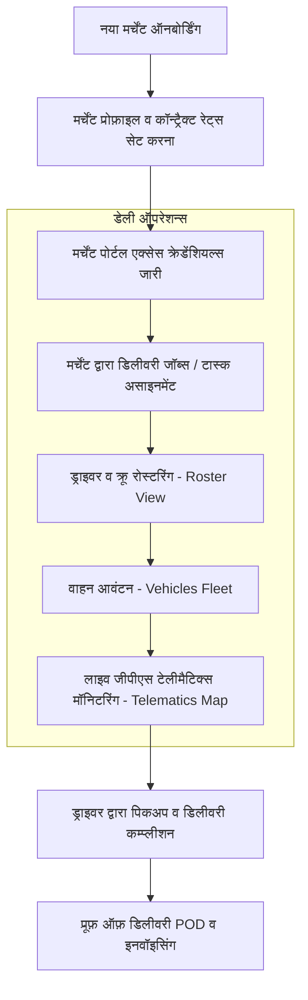
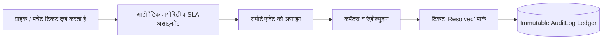

# DeliveryPlus CRM — Comprehensive Concept, Workflow & Design System Master Guide

> **दस्तावेज़ का उद्देश्य (Purpose of Document):**  
> यह मास्टर डॉक्यूमेंट **DeliveryPlus Merchant CRM** के पूरे बिज़नेस कॉन्सेप्ट (Concept), एंड-टू-एंड सिस्टम वर्कफ़्लो (Flows), विज़ुअल डिज़ाइन थीम और कलर्स (Theme & Theme Colors) तथा `docs/` फ़ोल्डर में मौजूद सभी टेक्निकल आर्किटेक्चर दस्तावेज़ों का एक संपूर्ण और एकीकृत गाइड है।

---

## 📑 Quick Navigation & Reference Index

| क्रमांक | सेक्शन | मुख्य विवरण |
| :---: | :--- | :--- |
| **1** | [🎯 1. हमारा Concept क्या है? (What is DeliveryPlus CRM?)](#1-हमारा-concept-क्या-है-what-is-deliveryplus-crm) | बिज़नेस मॉडल, विज़न, B2B लॉजिस्टिक्स व मर्चेंट ऑपरेशन्स |
| **2** | [🔄 2. एंड-टू-एंड बिज़नेस वर्कफ़्लो (System & User Flows)](#2-एंड-टू-एंड-बिज़नेस-वर्कफ़्लो-system--user-flows) | लीड-टू-कैश, मर्चेंट व फ़्लीट, सपोर्ट व ऑडिट फ्लो |
| **3** | [🎨 3. विज़ुअल थीम और थीम कलर्स (Design System & Color Tokens)](#3-विज़ुअल-थीम-और-थीम-कलर्स-design-system--color-tokens) | Hex Codes, UI पैलेट, टाइपोग्राफ़ी, कंपोनेंट्स |
| **4** | [📂 4. कोर आर्किटेक्चर डॉक्युमेंट्स का संपूर्ण एकीकरण (Linked Docs)](#4-कोर-आर्किटेक्चर-डॉक्युमेंट्स-का-संपूर्ण-एकीकरण-linked-docs) | `PROJECT_PLAN`, `DATABASE_DESIGN`, `API_SPECIFICATION`, `SECURITY_MODEL`, `TEST_PLAN` |
| **5** | [🚀 5. लोकल रन और एक्सेस क्रेडेंशियल्स](#5-लोकल-रन-और-एक्सेस-क्रेडेंशियल्स) | सर्वर यूआरएल, टेस्ट यूज़र्स, और पोर्ट्स |

---

## 1. हमारा Concept क्या है? (What is DeliveryPlus CRM?)

### 1.1. बिज़नेस विज़न (Business Vision)
**DeliveryPlus CRM** केवल एक साधारण कॉन्टैक्ट लिस्ट या डेटाबेस नहीं है; यह मूविंग, कूरियर, लास्ट-माईल लॉजिस्टिक्स और B2B मर्चेंट पार्टनरशिप्स के लिए डिज़ाइन किया गया एक **एंटरप्राइज़-ग्रेड ऑल-इन-वन ऑपरेशन्स और रिलेशनशिप मैनेजमेंट प्लेटफ़ॉर्म** है।

पारंपरिक CRM केवल सेल्स पाइपलाइन देखते हैं, जबकि DeliveryPlus CRM **कमर्शियल सेल्स** और **फ़्लीट/मर्चेंट ऑपरेशन्स** दोनों को एक ही डैशबोर्ड में जोड़ता है:



### 1.2. कोर वैल्यू प्रोपोजिशन (Core Value Pillars)
1. **मर्चेंट पार्टनरशिप हब (Merchant Operations & Portal)**:
   - B2B पार्टनर्स (जैसे रीटेल स्टोर्स, ई-कॉमर्स वेंडर्स, फ़र्नीचर वेयरहाउस) को ऑनबोर्ड करना, उनके कॉन्ट्रैक्ट रेट्स मैनेज करना, और उन्हें अपना सेपरेट मर्चेंट पोर्टल (`/merchant-portal`) देना।
2. **लीड-टू-कैश ऑटोमेशन (Lead-to-Cash Automation)**:
   - जब कोई कॉर्पोरेट या इंडिविजुअल क्लाइंट डिलीवरी/मूविंग इन्क्वायरी करता है, तो उसे लीड से कॉन्टैक्ट, कंपनी, ऑपर्च्युनिटी और ऑथोरिटेटिव कोटेशन में एक क्लिक में कन्वर्ट करना।
3. **लाइव टेलीमैटिक्स और फ़्लीट विज़िबिलिटी (Live Telematics & Vehicles)**:
   - सभी कमर्शियल ट्रक्स, वैन और ऑन-ड्यूटी ड्राइवर्स की लाइव जीपीएस लोकेशन, सर्विस शेड्यूलिंग, ओडोमीटर और रोस्टर को मैप (`/map`) पर ट्रैक करना।
4. **रोल-बेस्ड सिक्योर गवर्नेंस (RBAC & Compliance)**:
   - सुपर एडमिन, ऑपरेशन्स मैनेजर, सेल्स एग्जीक्यूटिव और कस्टमर सपोर्ट को स्ट्रिक्ट एक्सेस बाउंड्री देना और हर संवेदनशील गतिविधि का अपरिवर्तनीय ऑडिट लॉग (`/admin`) मेंटेन करना।

---

## 2. एंड-टू-एंड बिज़नेस वर्कफ़्लो (System & User Flows)

DeliveryPlus CRM के मुख्य तीन वर्कफ़्लो हैं:

### 2.1. वर्कफ़्लो 1: लीड-टू-कैश सेल्स फ़नल (Lead-to-Cash Lifecycle)
यह फ़्लो सेल्स टीम और नए क्लाइंट्स के बीच का सफ़र है:



---

### 2.2. वर्कफ़्लो 2: मर्चेंट पार्टनरशिप और फ़्लीट ऑपरेशन्स फ़्लो (Merchant & Fleet Operations)
यह फ़्लो लॉजिस्टिक्स, ऑर्डर्स और ड्राइवरों के दैनिक संचालन को संभालता है:



---

### 2.3. वर्कफ़्लो 3: सपोर्ट टिकटिंग और ऑडिट ट्रेल फ़्लो (Support & Compliance Flow)
क्लाइंट इश्यूज़ और ऑडिट कम्प्लायंस का सुरक्षित प्रबंधन:



---

## 3. विज़ुअल थीम और थीम कलर्स (Design System & Color Tokens)

DeliveryPlus CRM का विज़ुअल डिज़ाइन एक **प्रीमियम, मॉडर्न, डार्क-नेवी एंटरप्राइज़ एस्थेटिक** का पालन करता है। यह सादे सफ़ेद या जेनेरिक बूटस्ट्रैप स्टाइल से कहीं ऊपर उठकर एक प्रोफ़ेशनल फ़्लीट कमांड सेंटर का अहसास कराता है।

### 3.1. कोर ब्रांड कलर पैलेट (Brand Color Tokens)

| कलर नाम | हेक्स कोड (Hex) | आरजीबी / टेलविंड टोकन | यूआई में कहाँ इस्तेमाल होता है |
| :--- | :---: | :--- | :--- |
| **Deep Brand Navy** | `#0a1128` | `bg-[#0a1128]` / `brand-navy` | मुख्य साइडबार बैकग्राउंड, हेडर हाइलाइट्स, ब्रांड नेविगेशन कंटेनर |
| **Dark Midnight** | `#070d1e` | `bg-brand-dark` | डार्क मोडल बैकड्रॉप, बॉटम प्रोफ़ाइल बार, एक्सेंट बॉर्डर |
| **Vibrant Cyan / Teal** | `#00a8b5` | `text-brand-teal`, `bg-brand-teal` | एक्टिव मेन्यू टैब्स, प्राइमरी आइकॉन ग्लो, प्रोग्रेस बार, लिंक होवर्स |
| **Teal Deep Hover** | `#00909c` | `hover:bg-brand-teal-hover` | बटन्स और इंटरएक्टिव पिल्स के होवर इफेक्ट्स |
| **Electric Cyan** | `#06b6d4` | `bg-brand-cyan`, `border-cyan-500` | लाइव जीपीएस स्टेटस पल्स, ऑनलाइन इंडिकेटर्स, एक्टिव टेलीमैटिक्स |
| **Primary Action Coral** | `#f97316` | `bg-brand-orange` / `brand-coral` | मुख्य कॉल-टू-एक्शन (CTA) बटन्स, "New Lead", "Convert", "Save" |
| **Urgent Coral / Red** | `#ff5722` | `bg-brand-coral` | हाई-प्रायोरिटी अलर्ट्स, ओवरड्यू टास्क पिल्स, क्रिटिकल वार्निंग्स |
| **Slate Canvas Background**| `#f4f7fb` | `bg-[#f4f7fb]` | मुख्य पेज बॉडी बैकग्राउंड (आंखों को सुकून देने वाला हल्का स्लेटी-नीला) |
| **Surface White Glass** | `#ffffff` | `bg-white / glass-panel` | डेटा कार्ड्स, केपीआई विजेट्स, डेटा टेबल्स, फ़ॉर्म्स |

---

### 3.2. स्टेटस और अलर्ट कलर्स (Functional Status Tokens)

```text
🟢 Success / Won / Active  : #10b981 (Tailwind Emerald-500) -> Closed Won Deals, Active Drivers, Paid
🟡 Pending / In-Review     : #f59e0b (Tailwind Amber-500)   -> In-Progress Leads, Maintenance Due, Pending
🔴 High Priority / Overdue : #f43f5e (Tailwind Rose-500)    -> Urgent Tickets, Delayed Jobs, Lost Deals
🔵 Info / Navigation       : #3b82f6 (Tailwind Blue-500)    -> Open Tasks, Information Tooltips
```

---

### 3.3. टाइपोग्राफ़ी और यूआई एस्थेटिक्स (Typography & Component Rules)
- **फ़ॉन्ट फ़ैमिली**: `'Inter', system-ui, -apple-system, sans-serif` — अल्ट्रा-क्लीन, लेजिबल और कॉर्पोरेट-रेडी।
- **ग्लास-पैनल इफ़ेक्ट (`glass-panel`)**: `background: rgba(255, 255, 255, 0.95); backdrop-filter: blur(8px);` — हल्का आधुनिक ग्लास इफ़ेक्ट।
- **कस्टम स्क्रोलबार**: 6px चौड़ाई वाला स्मूद स्लेट स्क्रोलबार (`#cbd5e1` थंब) जो एंटरप्राइज़ डेंसिटी के साथ प्रीमियम दिखता है।
- **केपीआई कार्ड्स**: टॉप बॉर्डर पर सूक्ष्म कलर एक्सेंट (Cyan, Orange, Emerald, Purple), बड़े बोल्ड नंबर्स (उदा. `$428,500`), और साथ में प्रतिशत ट्रेंड पिल्स (`+12.4% vs last month`).

---

## 4. कोर आर्किटेक्चर डॉक्युमेंट्स का संपूर्ण एकीकरण (Linked Docs)

प्रोजेक्ट के `docs/` फ़ोल्डर में मौजूद सभी पाँच प्रमुख दस्तावेज़ों का विवरण और डायरेक्ट लिंक यहाँ दिए गए हैं:

### 4.1. 📋 [PROJECT_PLAN.md](file:///Users/rajjeet/Developer/deliveryplus-marchant-crm-main/docs/PROJECT_PLAN.md)
* **फ़ाइल पथ**: [`docs/PROJECT_PLAN.md`](file:///Users/rajjeet/Developer/deliveryplus-marchant-crm-main/docs/PROJECT_PLAN.md)
* **उद्देश्य**: संपूर्ण प्रोजेक्ट का विज़न, फ़ोल्डर स्ट्रक्चर, टेक्नोलॉजी स्टैक (React 18 + Vite + Express + MongoDB), और 8 डिलीवरी माइलस्टोन्स का विस्तृत रोडमैप।
* **प्रमुख घटक**:
  - मॉड्यूलर बैकएंड (`backend/src/modules/*`) और फ़ीचर-आधारित फ़्रंटएंड आर्किटेक्चर।
  - माइलस्टोन 1 से लेकर माइलस्टोन 8 तक की कम्प्लीट डिलीवरी ट्रैकिंग।

---

### 4.2. 🗄️ [DATABASE_DESIGN.md](file:///Users/rajjeet/Developer/deliveryplus-marchant-crm-main/docs/DATABASE_DESIGN.md)
* **फ़ाइल पथ**: [`docs/DATABASE_DESIGN.md`](file:///Users/rajjeet/Developer/deliveryplus-marchant-crm-main/docs/DATABASE_DESIGN.md)
* **उद्देश्य**: MongoDB और Mongoose पर आधारित स्कीमा आर्किटेक्चर और एंटिटी रिलेशनशिप्स।
* **प्रमुख कलेक्शन्स**:
  1. `users`: एडमिन, मैनेजर, सेल्स और सपोर्ट एजेंट्स के क्रेडेंशियल्स व सेशन्स।
  2. `leads`: इनबाउंड प्रोस्पेक्ट्स, स्कोरिंग और स्टेटस (`new`, `contacted`, `qualified`, `converted`)।
  3. `companies` & `contacts`: B2B कॉर्पोरेट क्लाइंट्स और उनके प्रमुख संपर्क व्यक्ति।
  4. `opportunities`: 6-स्टेज सेल्स पाइपलाइन (`discovery` से लेकर `closed_won`/`closed_lost`)।
  5. `quotations`: लाइन आइटम्स, डिस्काउंट, टैक्स और सर्वर-कैलकुलेटेड ग्रांड टोटल्स।
  6. `support_tickets`: एसएलए, कस्टमर कम्प्लेंट्स और रेज़ोल्यूशन हिस्ट्री।
  7. `audit_logs`: अपरिवर्तनीय कम्प्लायंस ट्रेल।

---

### 4.3. 🔌 [API_SPECIFICATION.md](file:///Users/rajjeet/Developer/deliveryplus-marchant-crm-main/docs/API_SPECIFICATION.md)
* **फ़ाइल पथ**: [`docs/API_SPECIFICATION.md`](file:///Users/rajjeet/Developer/deliveryplus-marchant-crm-main/docs/API_SPECIFICATION.md)
* **उद्देश्य**: सभी RESTful API एंडपॉइंट्स (`/api/v1/*`) का कम्प्लीट कैटलॉग और OpenAPI 3.0 (Swagger) स्पेसिफ़िकेशन।
* **प्रमुख एंडपॉइंट रूट्स**:
  - `/api/v1/auth`: लॉगिन, लॉगआउट, सेशन रिफ़्रेश, और करेंट यूज़र प्रोफ़ाइल।
  - `/api/v1/leads`: लीड क्रिएशन, फ़िल्टरिंग और एटॉमिक कन्वर्ज़न (`/leads/:id/convert`)।
  - `/api/v1/opportunities`: कानबन स्टेज ड्रैग-एंड-ड्रॉप और डील वैल्यू एग्रीगेशन।
  - `/api/v1/quotations`: स्ट्रिक्ट सर्वर-वैलिडेटेड फाइनेंशियल प्रपोजल्स।
  - `/api/v1/reports/dashboard`: लाइव मेट्रिक्स, रेवेन्यू चार्ट्स और केपीआई एग्रीगेशन।
  - `/api/v1/merchants`: मर्चेंट रोस्टर और मर्चेंट पोर्टल ऑथेंटिकेशन।
  - **इंटरएक्टिव स्वैगर यूआई**: `http://localhost:5001/api/v1/docs` पर लाइव उपलब्ध।

---

### 4.4. 🛡️ [SECURITY_MODEL.md](file:///Users/rajjeet/Developer/deliveryplus-marchant-crm-main/docs/SECURITY_MODEL.md)
* **फ़ाइल पथ**: [`docs/SECURITY_MODEL.md`](file:///Users/rajjeet/Developer/deliveryplus-marchant-crm-main/docs/SECURITY_MODEL.md)
* **उद्देश्य**: सुरक्षा वास्तुकला (Defense-in-Depth) और रोल-बेस्ड एक्सेस कंट्रोल (RBAC)।
* **सुरक्षा उपाय**:
  - **पासवर्ड प्रोटेक्शन**: Bcrypt (Cost Factor 12) के साथ हैशिंग; `password` फ़ील्ड हमेशा Mongoose में `select: false` रहता है।
  - **टोकन सिक्योरिटी**: HttpOnly और `SameSite=Strict` कुकीज़ (XSS और CSRF टोकन थेफ़्ट से बचाव)।
  - **रेट लिमिटिंग**: ब्रूट-फ़ोर्स अटैक्स से बचाव के लिए ऑथ रूट्स पर 15 मिनट में अधिकतम 10 प्रयास।
  - **RBAC मैट्रिक्स**: Super Admin, Admin, Sales Manager, Sales Rep, और Support Agent के बीच स्पष्ट अनुमतियाँ।

---

### 4.5. 🧪 [TEST_PLAN.md](file:///Users/rajjeet/Developer/deliveryplus-marchant-crm-main/docs/TEST_PLAN.md)
* **फ़ाइल पथ**: [`docs/TEST_PLAN.md`](file:///Users/rajjeet/Developer/deliveryplus-marchant-crm-main/docs/TEST_PLAN.md)
* **उद्देश्य**: ऑटोमेटेड टेस्टिंग स्ट्रेटेजी, टेस्ट सूट्स और एक्सेप्टेंस क्राइटेरिया।
* **टेस्ट कवरेज**:
  - 13/13 ऑटोमेटेड इंटीग्रेशन टेस्ट्स पास (हेल्थ, ऑथ लॉगिन, आरबीएसी, लीड कन्वर्ज़न, कानबन एग्रीगेशन, कोटेशन मैथ, ऑडिट लेजर, और मर्चेंट पोर्टल टोकन्स)।
  - टेस्ट रन करने की कमांड: `cd backend && npm test`।

---

## 5. लोकल रन और एक्सेस क्रेडेंशियल्स

### 5.1. लाइव रनिंग सर्विसेज़
- **फ़्रंटएंड वेब ऐप्लिकेशन**: [http://localhost:5173/](http://localhost:5173/)
- **बैकएंड रेस्ट एपीआई**: [http://localhost:5001](http://localhost:5001)
- **इंटरएक्टिव स्वैगर एपीआई डॉक्स**: [http://localhost:5001/api/v1/docs](http://localhost:5001/api/v1/docs)
- **सिस्टम हेल्थ चेक**: [http://localhost:5001/api/v1/health](http://localhost:5001/api/v1/health)

### 5.2. टेस्ट लॉगिन क्रेडेंशियल्स (All Passwords: `DeliveryPlus2026!`)
1. **Super Admin**: `admin@deliveryplus.com`
2. **Operations Manager**: `manager@deliveryplus.com`
3. **Sales Representative**: `sarah.sales@deliveryplus.com`
4. **Customer Support Agent**: `support@deliveryplus.com`

---

*यह दस्तावेज़ `docs/` फ़ोल्डर में DeliveryPlus इंजीनियरिंग मानकों के अनुसार तैयार और आर्काइव किया गया है।*
