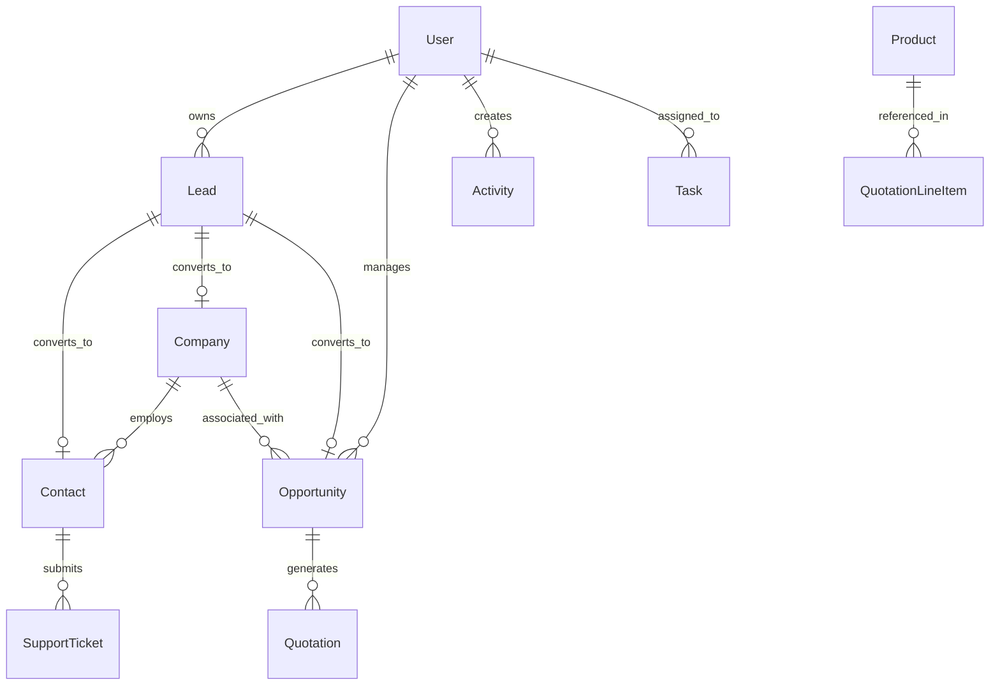

# DeliveryPlus CRM - Database Architecture & Schema Design

## 1. Overview & Architectural Principles
The database is built on **MongoDB** utilizing **Mongoose ODM**. It adheres to these core architectural principles:
- **Reference where independent**: Use `mongoose.Schema.Types.ObjectId` references (`ref`) when entities have independent life cycles (e.g. `User`, `Company`, `Contact`, `Opportunity`).
- **Embed where bounded**: Embedded subdocuments for tightly coupled, non-growing items (e.g., Quotation line items, Address subdocuments).
- **Compound indexing**: Targeted compound indexes on frequently queried combinations (e.g., status + owner, createdAt range, email uniqueness).
- **Soft Delete**: `isArchived: { type: Boolean, default: false }` for critical entities to allow recovery while preventing accidental data loss.
- **Auditing**: Every sensitive mutation updates or records an event in the `AuditLog` collection.

---

## 2. Collection Schemas & Entity Relationships

---

## 3. Schema Definitions

### 3.1. `User`
Stores system administrators, sales representatives, managers, and support agents.
- `_id`: ObjectId
- `name`: String, required, trim
- `email`: String, required, unique, lowercase, index
- `password`: String, required (hashed with bcrypt / cost 12)
- `role`: String, enum: `['superadmin', 'admin', 'manager', 'sales_rep', 'support_agent']`, default: `'sales_rep'`
- `department`: String (e.g., "Sales", "Operations", "Executive")
- `phone`: String
- `avatar`: String (URL or preset path)
- `isActive`: Boolean, default: true
- `lastLogin`: Date
- `loginHistory`: Array of `{ ip, userAgent, timestamp, status }`
- `createdAt`, `updatedAt`: Timestamps

### 3.2. `Lead`
Represents top-of-funnel inbound prospects.
- `_id`: ObjectId
- `firstName`: String, required
- `lastName`: String, required
- `email`: String, trim, lowercase, index
- `phone`: String
- `companyName`: String
- `title`: String
- `status`: String, enum: `['new', 'contacted', 'qualified', 'unqualified', 'converted']`, default: `'new'`, index
- `source`: String, enum: `['website', 'referral', 'cold_call', 'social', 'advertisement', 'event', 'other']`, default: `'website'`
- `leadScore`: Number, default: 10 (calculated based on engagement, company size, budget)
- `estimatedValue`: Number, default: 0
- `owner`: ObjectId (ref: `'User'`), index
- `notes`: String
- `isConverted`: Boolean, default: false
- `convertedAt`: Date
- `convertedContactId`: ObjectId (ref: `'Contact'`)
- `convertedCompanyId`: ObjectId (ref: `'Company'`)
- `convertedOpportunityId`: ObjectId (ref: `'Opportunity'`)
- `customFields`: Map of String/Mixed
- `isArchived`: Boolean, default: false
- `createdAt`, `updatedAt`: Timestamps

### 3.3. `Company`
Corporate accounts and client organizations.
- `_id`: ObjectId
- `name`: String, required, trim, index
- `industry`: String (e.g., "Logistics", "Retail", "Manufacturing", "Tech")
- `website`: String
- `phone`: String
- `address`: `{ street, city, state, postalCode, country }`
- `annualRevenue`: Number
- `employeeCount`: Number
- `owner`: ObjectId (ref: `'User'`), index
- `tier`: String, enum: `['standard', 'silver', 'gold', 'platinum']`, default: `'standard'`
- `status`: String, enum: `['prospect', 'active_client', 'inactive', 'churned']`, default: `'prospect'`
- `notes`: String
- `isArchived`: Boolean, default: false
- `createdAt`, `updatedAt`: Timestamps

### 3.4. `Contact`
Individual persons associated with companies or deals.
- `_id`: ObjectId
- `firstName`: String, required
- `lastName`: String, required
- `email`: String, required, trim, lowercase, index
- `phone`: String
- `company`: ObjectId (ref: `'Company'`), index
- `jobTitle`: String
- `department`: String
- `owner`: ObjectId (ref: `'User'`)
- `leadSource`: String
- `isPrimary`: Boolean, default: false
- `notes`: String
- `isArchived`: Boolean, default: false
- `createdAt`, `updatedAt`: Timestamps

### 3.5. `Opportunity`
Sales deals moving through custom stages of the pipeline.
- `_id`: ObjectId
- `title`: String, required, trim
- `company`: ObjectId (ref: `'Company'`), index
- `contact`: ObjectId (ref: `'Contact'`)
- `amount`: Number, required, default: 0
- `stage`: String, enum: `['discovery', 'qualification', 'proposal', 'negotiation', 'closed_won', 'closed_lost']`, default: `'discovery'`, index
- `probability`: Number, min: 0, max: 100, default: 20
- `expectedCloseDate`: Date, index
- `owner`: ObjectId (ref: `'User'`), index
- `priority`: String, enum: `['low', 'medium', 'high', 'critical']`, default: `'medium'`
- `lostReason`: String
- `wonDate`: Date
- `notes`: String
- `isArchived`: Boolean, default: false
- `createdAt`, `updatedAt`: Timestamps

### 3.6. `Activity`
Chronological interactions logged against leads, contacts, or opportunities.
- `_id`: ObjectId
- `type`: String, enum: `['call', 'meeting', 'email', 'note', 'stage_change', 'status_update']`, required
- `subject`: String, required
- `description`: String
- `durationMinutes`: Number
- `performedBy`: ObjectId (ref: `'User'`), required
- `lead`: ObjectId (ref: `'Lead'`), index
- `contact`: ObjectId (ref: `'Contact'`), index
- `company`: ObjectId (ref: `'Company'`), index
- `opportunity`: ObjectId (ref: `'Opportunity'`), index
- `createdAt`: Date, default: Date.now, index

### 3.7. `Task`
Actionable to-dos, reminders, and follow-ups.
- `_id`: ObjectId
- `title`: String, required
- `description`: String
- `dueDate`: Date, required, index
- `priority`: String, enum: `['low', 'medium', 'high', 'urgent']`, default: `'medium'`
- `status`: String, enum: `['pending', 'in_progress', 'completed', 'cancelled']`, default: `'pending'`, index
- `assignedTo`: ObjectId (ref: `'User'`), required, index
- `relatedType`: String, enum: `['Lead', 'Contact', 'Company', 'Opportunity', 'General']`, default: `'General'`
- `relatedId`: ObjectId
- `completedAt`: Date
- `createdAt`, `updatedAt`: Timestamps

### 3.8. `Product`
Catalogue of goods, logistics packages, moving services, and unit prices.
- `_id`: ObjectId
- `name`: String, required, trim
- `sku`: String, required, unique, uppercase
- `category`: String (e.g., "Freight", "Packing", "Storage", "Fleet")
- `unitPrice`: Number, required, min: 0
- `taxRate`: Number, default: 0
- `description`: String
- `isActive`: Boolean, default: true
- `createdAt`, `updatedAt`: Timestamps

### 3.9. `Quotation`
Proposals and price quotes with server-calculated line items.
- `_id`: ObjectId
- `quoteNumber`: String, required, unique (e.g. `QUO-2026-0001`)
- `opportunity`: ObjectId (ref: `'Opportunity'`)
- `company`: ObjectId (ref: `'Company'`), required
- `contact`: ObjectId (ref: `'Contact'`)
- `status`: String, enum: `['draft', 'sent', 'accepted', 'rejected', 'expired']`, default: `'draft'`
- `items`: [
    {
      product: ObjectId (ref: `'Product'`),
      description: String,
      quantity: Number,
      unitPrice: Number,
      discountPercent: Number,
      lineTotal: Number
    }
  ]
- `subtotal`: Number, required
- `discountAmount`: Number, default: 0
- `taxAmount`: Number, default: 0
- `totalAmount`: Number, required
- `validUntil`: Date
- `terms`: String
- `createdBy`: ObjectId (ref: `'User'`)
- `createdAt`, `updatedAt`: Timestamps

### 3.10. `SupportTicket`
Customer service cases and operational support tickets.
- `_id`: ObjectId
- `ticketNumber`: String, required, unique (e.g. `TCK-1001`)
- `subject`: String, required
- `description`: String, required
- `company`: ObjectId (ref: `'Company'`)
- `contact`: ObjectId (ref: `'Contact'`)
- `priority`: String, enum: `['low', 'medium', 'high', 'urgent']`, default: `'medium'`
- `status`: String, enum: `['open', 'in_progress', 'waiting_on_client', 'resolved', 'closed']`, default: `'open'`, index
- `category`: String, enum: `['billing', 'logistics', 'technical', 'complaint', 'general']`
- `assignedTo`: ObjectId (ref: `'User'`), index
- `comments`: [
    {
      author: ObjectId (ref: `'User'`),
      body: String,
      isInternal: Boolean,
      createdAt: { type: Date, default: Date.now }
    }
  ]
- `resolvedAt`: Date
- `createdAt`, `updatedAt`: Timestamps

### 3.11. `Notification`
In-app notifications for task reminders, assignments, and mentions.
- `_id`: ObjectId
- `recipient`: ObjectId (ref: `'User'`), required, index
- `title`: String, required
- `message`: String, required
- `type`: String, enum: `['lead_assigned', 'task_due', 'stage_change', 'quote_status', 'system']`
- `link`: String
- `isRead`: Boolean, default: false, index
- `createdAt`: Date, default: Date.now, index

### 3.12. `AuditLog`
Immutable compliance and security ledger.
- `_id`: ObjectId
- `actor`: ObjectId (ref: `'User'`), index
- `action`: String, required (e.g. `AUTH_LOGIN`, `LEAD_CONVERTED`, `OPPORTUNITY_STAGE_UPDATED`)
- `entityType`: String, required (e.g. `Lead`, `Opportunity`, `User`)
- `entityId`: ObjectId
- `details`: Object (safe metadata, previous/new stage, changed fields)
- `ip`: String
- `timestamp`: Date, default: Date.now, index

---

## 4. Indexing & Optimization Strategy
1. **Full-text search**: Text indexes across `name`, `email`, `companyName`, `title` on Leads, Contacts, and Companies for fast global search.
2. **Compound filters**:
   - `Leads`: `{ owner: 1, status: 1, createdAt: -1 }`
   - `Opportunities`: `{ stage: 1, owner: 1 }`
   - `Tasks`: `{ assignedTo: 1, status: 1, dueDate: 1 }`
   - `Notifications`: `{ recipient: 1, isRead: 1, createdAt: -1 }`
   - `AuditLog`: `{ entityType: 1, entityId: 1, timestamp: -1 }`
3. **Data Retention**:
   - Notifications: Retained for 90 days or indexed with TTL option if configured.
   - Audit logs: Read-only, append-only, retained indefinitely for enterprise compliance.
