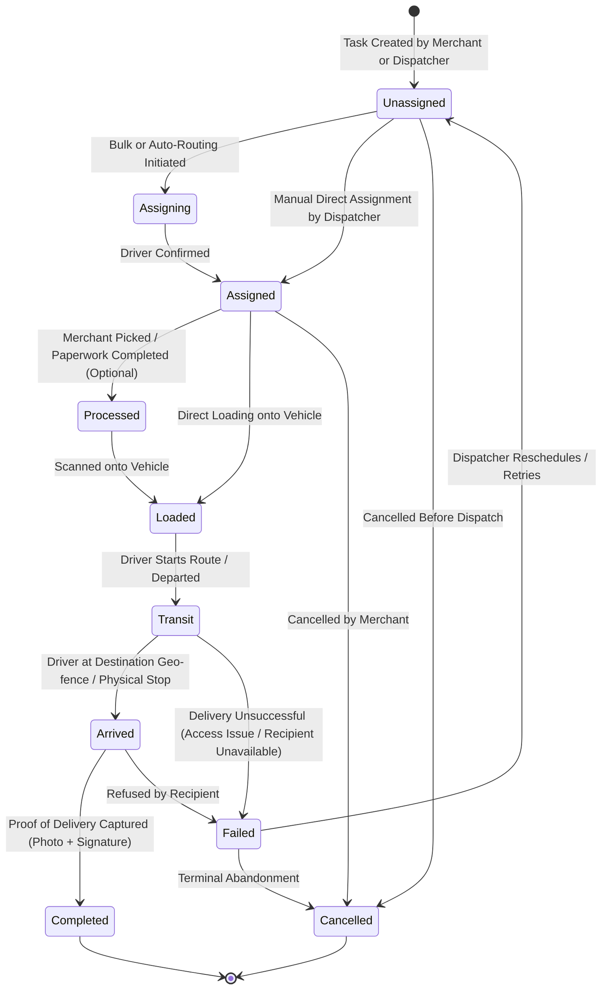

# DeliveryPlus Dispatcher & Merchant Operations — Workflow Architecture & State Transitions

This document defines the authoritative delivery lifecycle, state transition matrix, assignment logic, failure/retry policies, and concurrency control.

---

## 1. Canonical Delivery Task State Machine



---

## 2. Transition Rules & Precondition Matrix

| Current Status | Allowed Next Status | Triggering Role | Required Conditions / Payload |
| :--- | :--- | :--- | :--- |
| **`Unassigned`** | `Assigned` | Dispatcher, Admin, Authorized Merchant | `assignedDriver` must be provided and active |
| **`Unassigned`** | `Cancelled` | Dispatcher, Admin, Merchant (`delete_task`) | Cancellation reason logged |
| **`Assigned`** | `Unassigned` | Dispatcher, Admin | Reason for unassignment; driver workload decremented |
| **`Assigned`** | `Processed` | Warehouse Staff, Dispatcher | Optional staging step |
| **`Assigned`** | `Loaded` | Driver, Dispatcher | Package barcode verified |
| **`Processed`** | `Loaded` | Driver, Dispatcher | Package loaded into vehicle |
| **`Loaded`** | `Transit` | Driver, Dispatcher | Vehicle en route |
| **`Transit`** | `Arrived` | Driver, Geofence trigger | Driver within delivery radius |
| **`Transit`** | `Failed` | Driver, Dispatcher | `failureReason` required (e.g. "Customer Not Home", "Access Code Missing") |
| **`Arrived`** | `Completed` | Driver, Dispatcher | **Mandatory Completion Proof**: photo URL and/or recipient signature |
| **`Arrived`** | `Failed` | Driver, Dispatcher | `failureReason` required |
| **`Failed`** | `Unassigned` | Dispatcher, Admin | Reschedule: updates `completeBefore` date |
| **`Failed`** | `Cancelled` | Dispatcher, Admin | Permanent cancellation |

---

## 3. Optimistic Concurrency Control

To prevent two dispatchers from simultaneously assigning or modifying the same delivery task:
1. Every `DeliveryTask` document maintains a numerical `version` field (starting at `1`).
2. Updates require matching version in conditional query:
   ```javascript
   const updated = await DeliveryTask.findOneAndUpdate(
     { _id: taskId, version: currentVersion },
     { $set: updateFields, $inc: { version: 1 } },
     { new: true }
   );
   if (!updated) {
     throw new ConflictError('This task was modified by another user. Please refresh and try again.');
   }
   ```
3. The frontend passes the current `version` during mutation and surfaces an inline conflict alert if concurrent changes occurred.

---

## 4. Workload Accounting & Capacity Balancing

- Each driver has a capacity metric (default `100` units or max active tasks).
- When a task transitions into `Assigned`, `Loaded`, or `Transit`, the driver's `activeTasksCount` increments.
- When a task reaches terminal status (`Completed`, `Failed`, `Cancelled`) or is unassigned, `activeTasksCount` decrements.
- Over-capacity warnings are displayed in the Dispatcher UI when a driver exceeds threshold.
